# AI-Powered Energy Allocation, Storage Optimisation and Dynamic Pricing for a National EV Charging and Battery-Swapping Network

*Engineers' Ring of Honour 2026, Round 2 case study. All numbers come from the simulation in `code/` and the tables in `results/real/tables/` and `results/synthetic/tables/`.*

---

## 1. Executive summary

**The problem.** Five metro clusters (1,200 MW installed, 600 MWh of storage, 35% renewable energy) lose about 22% of forecast demand to queues at busy hubs and swap stock-outs at busy stations, waste energy (10% losses) and earn a thin EBITDA margin.

**Our answer.** A three-layer framework:
1. **Forecast** cluster demand, renewable output and the IEX price with machine learning (LightGBM), reconciled across clusters, plus forecast-error scenarios.
2. **Decide day-ahead** the IEX bids, DISCOM schedule, customer prices and a hub-steering incentive, using a stochastic optimiser (10 scenarios, CVaR term).
3. **Dispatch every hour** with a receding-horizon optimiser (MPC) for the stationary batteries, swap-rack charging and balancing purchases.

**Results** (full year, 23 Nov 2025 – 22 Nov 2026, forecasts strictly out-of-sample, real IEX prices and real ERA5 weather):

| KPI | Case target | Incumbent (calibrated) | Full AI framework |
|---|---|---|---|
| Service reliability | about 89.7% | 77.8% | **91.0%** |
| Storage and conversion losses | 8% | 9.9% | **7.8%** |
| EBITDA margin (network) | above 12% | 9.3% | **18.8%** |
| EBITDA margin (weakest cluster, Chennai) | above 12% | 6.0% | **13.7%** |
| Network EBITDA | – | ₹338 Cr | **₹824 Cr** |
| Network revenue | – | ₹3,634 Cr | ₹4,374 Cr |

**Four things to know up front:**
- **Reliability comes mostly from steering drivers to idle hubs with a paid incentive, plus rebalancing swap packs.** Forecasting and optimisation alone leave it near 78%. The result depends on how many drivers respond to the incentive (Section 11.2).
- **The loss target needs SiC chargers.** Software alone does not reduce losses. A full retrofit pays back slowly unless done at the normal replacement cycle (Section 12.3).
- **Some parts did not help on their own:** the ML price forecast did not beat yesterday's price, and the stochastic planner did not beat the deterministic one (Section 10.2).
- **We ran the whole study twice, on fully synthetic data and on real IEX prices and ERA5 weather** (Section 14). Reliability and loss results agree; margin is 16.3% on synthetic data and 18.8% on real data.

---

## 2. What the case requires

| Deliverable | Where it is answered |
|---|---|
| End-to-end strategy (forecasting, pricing, storage) | Sections 3 and 4 |
| Quantitative model (weather and renewables, cluster demand, storage, degradation, grid limits) | Section 6 |
| Assumptions with realistic Indian parameters | Section 5 |
| Simulation or scenarios proving scalability and economics | Sections 9 to 12 |

**Targets:** reliability 78% → about 90% (89.7%); losses 10% → 8%; EBITDA margin above 12% in every cluster.

**Hard constraints modelled:** 1,200 MW installed (60% DC fast charging, 40% swap); 600 MWh storage (240 MWh stationary batteries and 360 MWh swap-pack inventory in our split); 35% renewable energy under open-access contracts; hourly decisions aligned to IEX; prices within ±20% of the market tariff; 5% of capacity and pack inventory kept uncommitted.

**A point the case does not state.** Electricity cannot move between metros, so "balancing across clusters" works through (a) the exchange, (b) moving swap packs *within* a cluster, and (c) steering customers across hubs and hours with prices.

---

## 3. Approaches considered

| Layer | Options | Chosen | Why |
|---|---|---|---|
| Demand and renewable forecasting | SARIMAX / Prophet; **LightGBM**; deep learning | LightGBM plus hierarchical reconciliation | Strong on tabular weather and calendar features, fast, explainable |
| Uncertainty | Quantile models; conformal; **residual-day bootstrap** | Residual-day bootstrap | Keeps the real correlation between hours and variables |
| Bidding and storage | Rules; deterministic MPC; **two-stage stochastic with CVaR**; reinforcement learning | Stochastic plan plus real-time MPC | Matches the IEX structure (commit day-ahead, adjust in real time). RL is hard to certify against hard constraints; kept for later |
| Pricing | Elasticity curves; bandits; fleet contracts | Elasticity-aware pricing in the ±20% band, with a steering incentive | Simple and defensible |
| Degradation | Linear cost; semi-empirical | Semi-empirical, **fitted from the battery state-of-health records** | Heat raises wear cost |

---

## 4. The framework

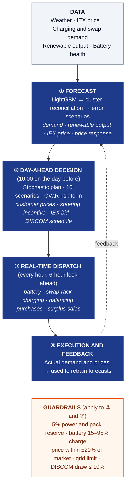

**Guardrails built in:** 5% power and pack reserve; battery state of charge between 15% and 95%; customer price in [0.8, 1.2] × market tariff, with the volume-weighted daily average kept to about +4%; grid connection limit; DISCOM unscheduled draw limited to 10% of connection. Planning uses only information available at 10:00 of the day before (forecast weather, yesterday's prices).

---

## 5. Data and assumptions

### 5.1 Data: what is real and what is synthetic

| Data | Source | Real or synthetic |
|---|---|---|
| IEX day-ahead price, hourly, 23 Nov 2021 – 22 Nov 2026 | IEX India website (Day-Ahead Market → Market Snapshot). One 30-day gap (6 Apr – 5 May 2025) is filled with nearby average values | **Real** |
| Weather (temperature, cloud, wind, sunshine), hourly, five cities | ERA5 weather data from Open-Meteo | **Real** |
| Solar and wind output per MW | Calculated from the real weather. The amount of solar and wind each cluster holds is our assumption, set so renewables give 35% of energy | **Calculated from real weather** |
| Weather forecast errors | Added by us to imitate a real weather forecast | Synthetic |
| Charging and swap demand, customer price logs | Made by our code | **Synthetic** |
| Battery health records | Made by our code | **Synthetic** |

**Sources.**
- IEX India, Day-Ahead Market → Market Snapshot: https://www.iexindia.com/market-data/day-ahead-market/market-snapshot
- Open-Meteo Historical Weather API (ERA5), licence CC BY 4.0: https://open-meteo.com/en/docs/historical-weather-api and https://open-meteo.com/en/license
- Hersbach, H. et al. (2020), "The ERA5 global reanalysis", *Quarterly Journal of the Royal Meteorological Society* 146, 1999–2049: https://doi.org/10.1002/qj.3803
- Hersbach, H. et al., "ERA5 hourly data on single levels from 1940 to present", Copernicus Climate Change Service (C3S) Climate Data Store: https://doi.org/10.24381/cds.adbb2d47 (contains modified Copernicus Climate Change Service information)

**Where the scripts are.** The two data scripts are in the `scripts/` folder of the code repository: `download_iex_dam.py` (IEX prices) and `download_era5_weather.py` (weather). The raw data files are not included, so run the scripts to get them. Please check each provider's terms before sharing the raw files. A synthetic mode (`DATA_MODE=synthetic`) runs without any download.

**Training and test.** Training period: 23 Nov 2021 – 22 Nov 2025. Test period: 23 Nov 2025 – 22 Nov 2026. The model never saw the test year while learning.

**Why we show both synthetic and real.** The case gives no data, so we first built the model on fully made-up data. We then switched to real prices and weather. Section 14 shows both side by side.

### 5.2 Key assumptions (full list in `code/params.py`)

| Area | Assumption |
|---|---|
| Network | 300 / 280 / 260 / 200 / 160 MW (Delhi, Mumbai, Bengaluru, Hyderabad, Chennai); stationary storage 60 / 56 / 52 / 40 / 32 MWh at 0.5C; pack inventory 90 / 84 / 78 / 60 / 48 MWh |
| Grid connection | 1.0 × the 99th-percentile load of each cluster (about 145 / 145 / 111 / 78 / 54 MW) |
| Energy cost | Renewable PPA ₹4.2/kWh, paid on all energy generated; IEX landed cost = price + ₹0.9 adder; 3% transmission loss; DISCOM EV tariffs ₹4.5 / 5.9 / 5.0 / 6.0 / 6.3/kWh with time-of-day factors (0.8, 1.0, 1.2); unscheduled draw at 1.25 × tariff; surplus sold at 0.75 × IEX price |
| Customer prices | DC ₹17.5/kWh and swap ₹38/kWh (includes pack service) at the market tariff, which moves with yesterday's IEX average (10% pass-through) |
| Variable costs | 20% of revenue (site-host share 15%, payment 2%, O&M 3%); swap logistics ₹1.2/kWh plus pack cycle wear ₹6.0/kWh |
| Efficiency (baseline) | DC charger 93.5%, swap charger 92.5%, site distribution and cooling 2.4%, battery 91% round trip |
| Efficiency (SiC) | DC 96.0%, swap 95.0% |
| Battery wear | Fitted from state-of-health records: stationary about 6,040 full cycles, packs about 2,490 cycles to 80% health, wear up about 3% per °C above 25 °C; capex ₹14,000/kWh (stationary), ₹15,000/kWh (packs) |
| Demand response | Own-price elasticity −0.44 to −0.59 (DC) and −0.23 to −0.30 (swap) by time of day, estimated from price logs within ±0.04 (average error 0.01); 30% of suppressed volume returns within 1–4 hours |
| Hubs and stations | 20 hubs per cluster with equal chargers and 20 swap stations with equal racks; demand across them is lognormally dispersed (hot and cold sites) |
| Steering | The optimiser pays a loyalty credit (0–20% of tariff) on energy moved from overloaded to idle hubs. Share moved = 0.70 × (1 − exp(−credit/10%)); credit is a cost |
| Pack rebalancing | Repositions 60% of rack inventory in line with forecast station demand; costs ₹1,500/MWh swapped |

### 5.3 Calibration (how the baseline matches the case)
We tuned a few parameters so the **incumbent's** operations reproduce the case's starting point:

| Parameter tuned | Reproduces |
|---|---|
| Demand dispersion across hubs (lognormal sd 1.12–1.17) | Cluster reliability 76 / 74 / 80 / 81 / 83%, about 77.8% overall |
| Demand dispersion across swap stations (sd 0.96–1.10) | Swap fill rate 82 / 80 / 88 / 92 / 93% (stock-outs concentrated in Delhi and Mumbai) |
| Charger, distribution and battery efficiencies | Losses 9.9% |
| Fixed cost per cluster (₹151–404 Cr/yr) | Starting margins 10 / 12 / 8 / 7 / 6%, about 9.3% overall |
| Incumbent schedules 92% of its forecast net load, buying each hour from the cheaper of IEX or DISCOM | Under-scheduling on cloudy and hot days |

*The starting margins and fixed costs are our assumptions; the case only says margins must stay above 12%.*

---

## 6. The quantitative model

All quantities are hourly, per cluster. Energy is in MWh; prices in ₹/MWh.

### 6.1 Weather, renewables and demand

$$\text{SolarCF}_t=\frac{\text{GHI}_t}{1000}\,\bigl(1+\gamma\,(T^{\text{cell}}_t-25)\bigr)\,(1-0.14),\qquad T^{\text{cell}}_t=T_t+0.03\,\text{GHI}_t,\qquad \gamma=-0.004$$

$$\text{WindCF}_t=f_{\text{turbine}}\!\bigl(v^{100\,\text{m}}_t\bigr),\qquad \text{RE}_t=\text{MW}^{\text{sol}}\,\text{SolarCF}_t+\text{MW}^{\text{wind}}\,\text{WindCF}_t$$

$$D_t=\text{base}\cdot s(h_t,\text{day type})\cdot g_t\cdot\bigl(1+0.016\,(T_t-30)^{+}\bigr)\cdot r_t\cdot\xi_t$$

$$D^{\text{posted}}_t=D^{\text{ref}}_t\,m_t^{\,\epsilon(h_t)}+\rho\sum_{j=1}^{4}w_j\Bigl(D^{\text{ref}}_{t-j}-D^{\text{ref}}_{t-j}\,m_{t-j}^{\,\epsilon(h_{t-j})}\Bigr),\qquad \rho=0.30$$

Here `m_t` is the price multiplier against the market tariff (0.8 to 1.2), `ε` the price elasticity, `ρ` the share of suppressed volume that returns, `ξ_t` demand noise and `r_t` a rain effect. Weather therefore moves renewable supply, charging load and wear together. Renewable energy is paid for whether it is used or not.

### 6.2 Hubs and stations (the spatial mismatch)
Cluster DC demand `D` splits over 20 equal-capacity hubs with weights `w_j`:

$$\text{served}=\sum_{j=1}^{20}\min\bigl(D\,w_j,\;c\bigr)+\sigma\,\min\!\Bigl(\sum_{j}(D\,w_j-c)^{+},\;\sum_{j}(c-D\,w_j)^{+}\Bigr),\qquad \sigma=0.70\Bigl(1-e^{-\text{credit}/10\%}\Bigr)$$

`c` is the capacity per hub (derated above 38 °C, with a 0.70 peaking factor). Swap demand splits the same way over 20 stations. Each station can hand out a share of the rack energy equal to its inventory share; rebalancing moves inventory toward high-demand stations.

### 6.3 Energy balance and grid limit

$$\text{RE}^{\text{used}}_t+(1-\tau)\,q_t+z_t+v_t+d_t=\frac{s^{\text{dc}}_t/\eta_{\text{dc}}+p^{\text{sw}}_t}{1-\delta}+b_t+u_t$$

$$\text{RE}^{\text{used}}_t+(1-\tau)\,q_t+z_t+v_t\le G,\qquad v_t\le 0.10\,G$$

Here `q` is the IEX bid, `z` the scheduled DISCOM energy, `v` the unscheduled draw, `d` and `b` the battery discharge and charge, `u` the surplus sold, `s^dc` the DC energy served, `p^sw` the swap-rack charging, `τ` the transmission loss and `δ` the site loss.

### 6.4 Storage

$$\text{SoC}_{t+1}=(1-0.0001)\,\text{SoC}_t+0.955\,b_t-\frac{d_t}{0.955},\qquad 0.15\,E\le \text{SoC}_t\le 0.95\,E$$

$$F_{t+1}=(1-0.00045)\,F_t+\eta_{\text{sw}}\,p^{\text{sw}}_t-h_t,\qquad F_t\ge F^{\text{res}}$$

Swapping is a 1-for-1 exchange: an empty pack goes straight into the rack and recharges, so the packs in the racks stay constant. `F` is the charged energy in the racks, `h` the energy handed out to customers and `F^res` the 5% reserve of pack inventory.

### 6.5 Degradation and heat

$$c^{\text{wear}}_t=\frac{\text{capex}}{L_{\text{cycle}}}\,\bigl(1+0.03\,(T_t-25)^{+}\bigr)\quad\text{per MWh discharged}$$

Here `L_cycle` is the fitted cycle life. Full packs held idle carry a calendar cost. Heat also raises demand, derates chargers, and increases wear.

### 6.6 Objective (day-ahead stochastic plan)

$$\max\;\;(1-\kappa)\,\mathbb{E}[\Pi]+\kappa\,\text{CVaR}_{80\%}[\Pi],\qquad \kappa=0.3$$

$$\Pi=R-(P+a)\,q-T\,z-1.25\,T\,v+0.75\,P\,u-C^{\text{RE}}-C^{\text{wear}}-C^{\text{cal}}-C^{\text{logistics}}-C^{\text{steer}}+V^{\text{service}}+V^{\text{terminal}}$$

Here `R` is net revenue (DC and swap), `P` the IEX price, `a` the ₹0.9/kWh adder, `T` the DISCOM tariff and `u` the surplus sold. The other terms are renewable cost (different in each scenario), battery wear, pack calendar cost, swap logistics, steering credits, a service premium and the terminal value of stored energy. The 5% reserve and the constraints in 6.3–6.4 apply in every scenario.

### 6.7 Pricing and steering
For each hour the optimiser chooses the price multiplier in [0.8, 1.2] **and** the steering credit that maximise margin, given the estimated elasticity, hub capacity and supply limits. A daily constraint keeps the volume-weighted average price at or below +4% of the market tariff (enforced with a Lagrange multiplier). The credit is paid only on energy actually redirected, and it is a cost both in the plan and in reported EBITDA.

### 6.8 Real-time dispatch
Every hour, a 6-hour LP re-optimises storage, pack charging and balancing with the latest state and corrected forecasts; the bids `q` and `z` stay as planned. Customers are served first, then pack charging, then battery charging. Shortfalls are met by the cheaper of unscheduled DISCOM draw or battery discharge. A feeder cut is assumed to persist over the horizon once observed.

### 6.9 KPI definitions

$$\text{Reliability}=\frac{\sum_t\bigl(s^{\text{dc}}_t+s^{\text{sw}}_t\bigr)}{\sum_t D^{\text{posted}}_t},\qquad \text{Losses}=\frac{L^{\text{charger}}+L^{\text{distribution}}+L^{\text{battery}}+L^{\text{idle}}}{E^{\text{consumed}}}$$

$$\text{EBITDA}=\text{Revenue}-C^{\text{energy}}-C^{\text{variable}}-C^{\text{steer}}-C^{\text{wear}}-C^{\text{fixed}}$$

Network averages weight reliability by demand, losses by energy consumed, and renewable use by renewable generated. We also report volume against reference-price demand so reliability cannot be inflated by raising prices.

---

## 7. Forecasting results (test year, out-of-sample)

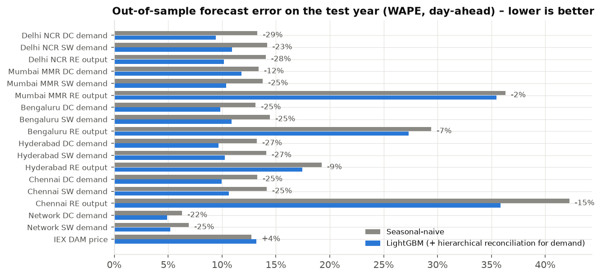

| Series | Naive error | ML error | Change |
|---|---|---|---|
| Cluster DC demand | 13.1–13.4% | 9.4–11.8% | −12% to −29% |
| Cluster swap demand | 13.8–14.5% | 10.3–10.9% | −23% to −27% |
| Renewable output | 14–42% | 10–36% | −2% to −28% |
| IEX price | 12.7% | 13.2% | **+4% (worse)** |

- **Demand and renewables improve clearly**, but demand error stays near 10% because the hourly noise is largely irreducible.
- **The ML price forecast did not beat "yesterday's price."** IEX prices in this period were hard to predict from calendar and weather alone. Our framework still uses the ML forecast; the effect is small because most energy comes from DISCOM and renewables.
- **Renewable forecasts help least** in Mumbai, Bengaluru and Chennai (−2% to −15%), the three clusters with the most wind.
- **Error bands:** the bootstrapped P10–P90 band covers 71–80% of outcomes (nominal 80%).
- **Elasticity estimates** from price logs are within ±0.04 of the true values (average error 0.01).

---

## 8. One operating day

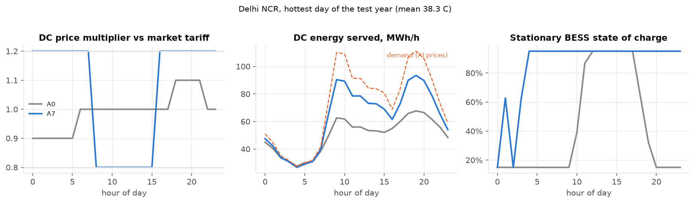

On the hottest day of the test year in Delhi, the framework sets the DC price at the +20% limit overnight and in the evening, and at −20% from 08:00 to 15:00, when cheap solar energy is available. This moves demand into the middle of the day. It serves more DC energy than the incumbent all day, about 40% more at the evening peak (about 93 against 68 MWh in the peak hour). The framework charges the stationary battery to full early in the morning and keeps it full on this day, while the incumbent charges at midday and drains the battery at 17–20 h by rule.

---

## 9. Results

### 9.1 The improvement ladder

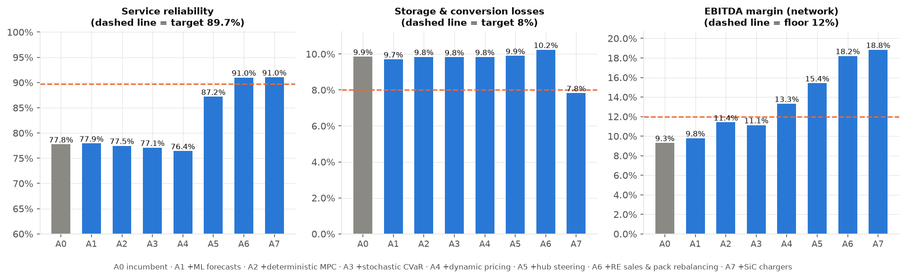

| Step | Reliability | Losses | EBITDA margin | Weakest cluster margin |
|---|---|---|---|---|
| A0 Incumbent rules | 77.8% | 9.9% | 9.3% | 6.0% |
| A1 + ML forecasts | 77.9% | 9.7% | 9.8% | 6.7% |
| A2 + deterministic MPC | 77.5% | 9.8% | 11.4% | 8.9% |
| A3 + stochastic CVaR plan | 77.1% | 9.8% | 11.1% | 8.5% |
| A4 + dynamic pricing | 76.4% | 9.8% | 13.3% | 10.3% |
| A5 + hub steering | 87.2% | 9.9% | 15.4% | 11.8% |
| A6 + renewable sales and pack rebalancing | 91.0% | 10.2% | 18.2% | 13.1% |
| A7 + SiC chargers | **91.0%** | **7.8%** | **18.8%** | **13.7%** |

**Contribution of each lever:**
- **A1 (forecasts):** +0.5 pts margin; renewable use rises from 88% to 91%.
- **A2 (optimiser):** +1.6 pts margin, from cheaper purchase mix and renewable use (92%).
- **A3 (stochastic plan):** no gain (−0.3 pts); see Section 10.2.
- **A4 (dynamic pricing):** +2.2 pts margin, but reliability slips 0.7 pts (prices rise at the peak).
- **A5 (hub steering):** reliability +10.8 pts and margin +2.1 pts, **net of ₹78 Cr of incentive credits** (rising to ₹89 Cr at A7 as more volume is served).
- **A6 (renewable sales and pack rebalancing):** reliability +3.8 pts (swap fill 81% → 99%), margin +2.8 pts. Selling surplus renewable energy lifts renewable use to 99% and the stationary battery is used 2× more.
- **A7 (SiC chargers):** losses −2.4 pts, margin +0.6 pts.

### 9.2 By cluster

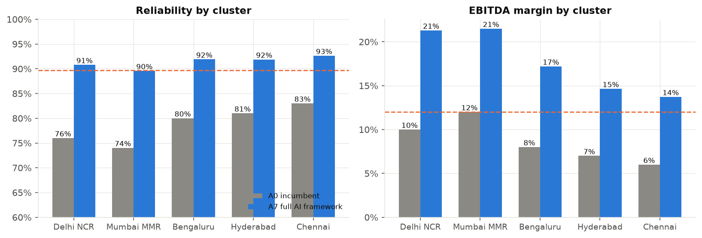

| Cluster | Reliability (A0 → A7) | EBITDA margin (A0 → A7) | EBITDA ₹ Cr (A0 → A7) |
|---|---|---|---|
| Delhi NCR | 76.0% → 90.8% | 10.0% → 21.3% | 91 → 239 |
| Mumbai MMR | 74.0% → **89.6%** | 12.0% → 21.5% | 127 → 284 |
| Bengaluru | 80.0% → 91.9% | 8.0% → 17.2% | 59 → 150 |
| Hyderabad | 81.0% → 91.9% | 7.0% → 14.6% | 37 → 89 |
| Chennai | 83.0% → 92.6% | 6.0% → 13.7% | 24 → 61 |

*(Cluster figures sum to ₹823 Cr due to rounding.)*

All clusters pass the 12% margin floor. Mumbai is 0.1 point short of 89.7% on reliability; Hyderabad and Chennai have the thinnest margins.

### 9.3 Losses

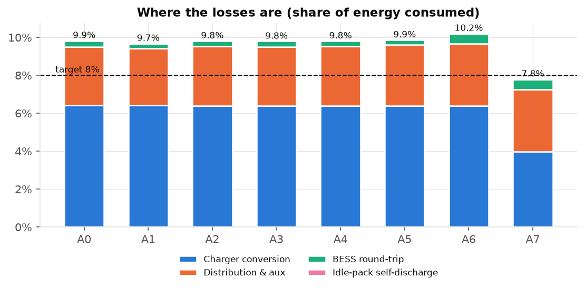

| Component (share of energy consumed) | A0 | A6 | A7 |
|---|---|---|---|
| Charger conversion | 6.4% | 6.4% | **4.0%** |
| Distribution and auxiliary | 3.1% | 3.3% | 3.3% |
| Battery round trip | 0.3% | 0.5% | 0.5% |
| Idle-pack self-discharge | 0.06% | 0.04% | 0.04% |
| **Total** | 9.9% | 10.2% | 7.8% |

- **Charger conversion is the dominant loss**, so only hardware moves the total meaningfully.
- **Battery losses rise slightly** (0.3% → 0.5%) because the framework now uses the batteries more, to monetise price spreads and surplus renewables.

---

## 10. Risk, stress tests and honest findings

### 10.1 Stress scenarios

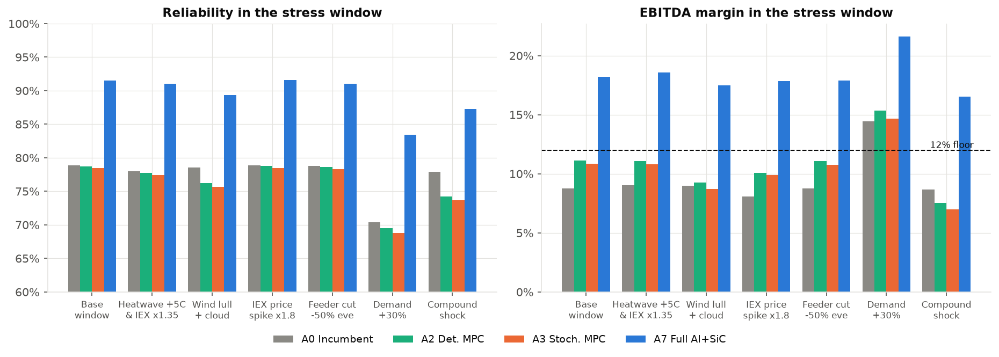

Each runs a 25-day window starting late March 2026, with the shock applied to actuals only (forecasts do not see it). The heatwave row includes an IEX price rise of 35%, and the compound row combines heat, wind lull, a price spike (×1.8) and a feeder cut. Margins are for the window, with fixed cost pro-rated.

| Scenario | Incumbent: reliability / margin | Full AI: reliability / margin |
|---|---|---|
| Base window | 78.9% / 8.8% | 91.6% / 18.2% |
| Heatwave +5 °C and IEX × 1.35 (14 days) | 78.0% / 9.0% | 91.0% / 18.6% |
| Wind lull and cloud, renewables × 0.3 (7 days) | 78.5% / 9.0% | 89.4% / 17.5% |
| IEX price × 1.8 (10 days) | 78.9% / 8.1% | 91.6% / 17.9% |
| DISCOM feeder cut −50% at 17–23 h (10 days) | 78.8% / 8.8% | 91.0% / 17.9% |
| Demand +30% (25 days) | 70.4% / 14.4% | 83.4% / 21.6% |
| Compound shock (10 days) | 77.9% / 8.7% | 87.3% / 16.5% |

- **The full framework beats the incumbent in every scenario**, with network margin staying at 16.5% or more.
- **Cluster-level margins in short windows can dip below 12%** (the weakest cluster reaches 8.7% under the compound shock), because a 25-day window is noisy. Annual cluster margins are all above 12%.
- **MPC without pricing and steering is fragile.** In the wind lull and the compound shock, the MPC-only versions (A2, A3) did *worse* than the incumbent on reliability (75.7–76.3% and 73.6–74.2%), because they rely on forecasts the shock invalidated.

### 10.2 What did not work as expected
1. **The ML price forecast is no better than yesterday's price** (13.2% vs 12.7% error).
2. **Stochastic planning did not beat deterministic MPC** (11.1% vs 11.4% margin; reliability 77.1% vs 77.5%). The real-time MPC already absorbs most forecast error. We keep it as a hedge, but the evidence for its value is weak.
3. **Dynamic pricing alone lowers reliability** (−0.7 pts) while raising margin; it only improves reliability together with steering.

### 10.3 Statistical spread
A 7-day-block bootstrap (circular) of daily results, 4,000 resampled years:

| | P5 | P50 | P95 |
|---|---|---|---|
| Network margin, incumbent | 8.6% | 9.3% | 10.0% |
| Network margin, full AI | 17.8% | 18.8% | 19.9% |
| Reliability, full AI | 90.9% | 91.0% | 91.2% |

In 99% of resampled years every cluster stays above a 12% margin. **This range is too narrow to be a real risk estimate**: it only reshuffles days inside one simulated year and excludes year-to-year shifts in prices, demand growth and policy.

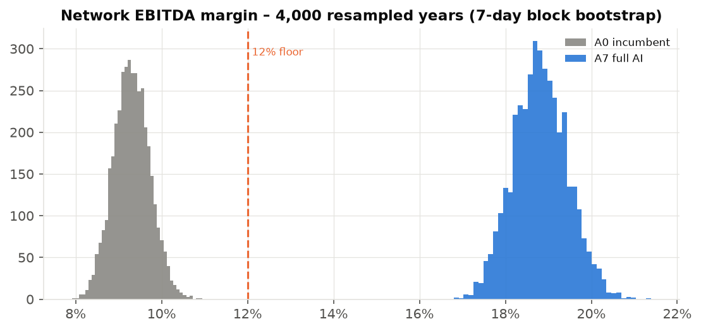

---

## 11. Sensitivity

### 11.1 One-at-a-time perturbations (full AI, full year)

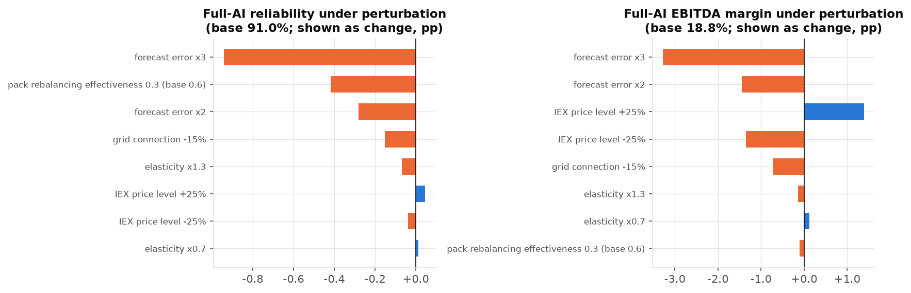

| Perturbation | Reliability | EBITDA margin | Weakest cluster |
|---|---|---|---|
| Base | 91.0% | 18.8% | 13.7% |
| Elasticity × 0.7 | 91.1% | 19.0% | 13.9% |
| Elasticity × 1.3 | 91.0% | 18.7% | 13.5% |
| Forecast error × 2 (demand, renewables and price) | 90.8% | 17.4% | 12.2% |
| Forecast error × 3 | 90.1% | 15.6% | **10.1%** |
| IEX price −25% | 91.0% | 17.5% | 13.5% |
| IEX price +25% | 91.1% | 20.2% | 14.1% |
| Grid connection −15% | 90.9% | 18.1% | 13.3% |
| Pack rebalancing half as effective (0.3 vs 0.6) | 90.6% | 18.7% | 13.7% |

- **Forecast quality is the most important operational sensitivity:** tripling forecast error costs 3 points of margin and pushes the weakest cluster below 12%. Investing in forecasting and data matters.
- **Higher IEX prices raise the full framework's margin** because customer tariffs follow the exchange (10% pass-through) while the framework buys mostly from DISCOM and renewables. The incumbent buys more on the exchange: its margin is 10.5% at −25% and 8.7% at +25%.
- **Elasticity matters little**, because pricing uses estimated, not true, elasticity.

### 11.2 Steering effectiveness (the critical assumption)

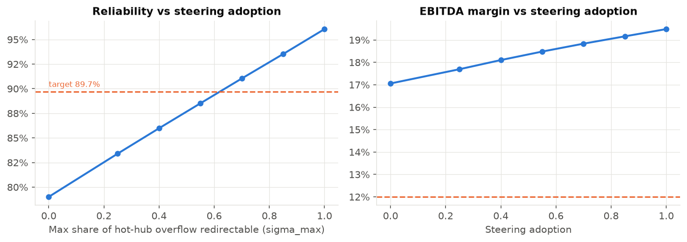

`σ_max` is the maximum share of overloaded-hub energy that the incentive can redirect (base 0.70).

| σ_max | Reliability | EBITDA margin | Incentive cost |
|---|---|---|---|
| 0.00 (no steering) | 79.0% | 17.1% | ₹0 |
| 0.25 | 83.4% | 17.7% | ₹32 Cr |
| 0.40 | 86.0% | 18.1% | ₹51 Cr |
| 0.55 | 88.5% | 18.5% | ₹70 Cr |
| **0.70 (base)** | **91.0%** | **18.8%** | **₹89 Cr** |
| 0.85 | 93.5% | 19.2% | ₹108 Cr |
| 1.00 | 96.1% | 19.5% | ₹127 Cr |

- **Break-even for the 89.7% reliability target is σ_max ≈ 0.62.**
- **The profit target does not depend on steering:** with no steering, margin is still 17.1% (weakest cluster 12.2%).
- **Reliability depends almost entirely on steering** (about +1.7 reliability points per 0.1 of σ_max).
- **Our 0.70 is an assumption.** A pilot should measure the real response before committing.

---

## 12. Scalability and economic feasibility

### 12.1 Computational scalability

| Task | Time |
|---|---|
| Hourly simulation of one cluster for a full year with the full framework (day-ahead stochastic plan plus 8,760 hourly MPC solves) | about 90 s on one core |
| Incumbent rules for one cluster-year | about 1 s |
| Full suite of 270 simulations (ladder, steering sweep, stress, sensitivities) | 14 minutes on 12 cores |

- **Each cluster is independent**, so compute grows linearly and parallelises across cores. At about 90 seconds per cluster-year, 50 clusters would take about 75 minutes on one core, or about 6 minutes on 12 cores.
- **The decision windows are generous:** day-ahead has hours before the IEX gate, real-time has minutes.

### 12.2 Economics (model results)

| | Incumbent | Full AI (A6) | + SiC (A7) |
|---|---|---|---|
| Revenue | ₹3,634 Cr | ₹4,373 Cr | ₹4,374 Cr |
| EBITDA | ₹338 Cr | ₹796 Cr | ₹824 Cr |
| Energy delivered | 1,769 GWh | 2,070 GWh | 2,071 GWh |

- **Uplift before hardware: about ₹458 Cr a year**, from higher energy sales, cheaper purchases and fewer wasted renewables.
- **Costs of the framework itself are already inside these numbers:** steering credits (₹89 Cr), pack rebalancing logistics and battery wear.
- **Platform cost is not modelled.** As an illustrative assumption (not from the model), data, ML and operations staff of ₹60 Cr one-off plus ₹20 Cr a year would pay back within months at this uplift.

### 12.3 The SiC charger question
SiC chargers add about ₹28 Cr a year, and are the only route to the 8% loss target in our model.

| Option | Assumed cost | Payback on ₹28 Cr/yr |
|---|---|---|
| Full retrofit of power modules this year (₹3,500/kW DC + ₹2,500/kW swap) | about ₹372 Cr | about 13 years |
| SiC at the normal replacement cycle (₹900/kW DC + ₹700/kW swap incremental) | about ₹98 Cr | about 3.5 years |

*Costs are our assumptions; replace with vendor quotes.* A full retrofit is hard to justify on savings alone, so the 8% target is a management decision: accept a phased 2–3 year path, or find other loss levers we did not model (DC-coupled storage, load-aware charger module sequencing, cooling).

### 12.4 Where storage matters
In the final model the stationary battery earns its place: it delivers about 122 GWh a year (6% of energy), used for price spreads, surplus renewable energy and peak support. Its contribution to reliability is still modest, because the main constraint is hub overflow, not energy.

---

## 13. Model verification and quality assurance
The model was independently code-reviewed and every result was re-run after the checks below.
- **Units audit:** all prices are in ₹/MWh inside the optimiser. The audit found and corrected a ₹/kWh versus ₹/MWh mismatch in the IEX forecast path.
- **Swap-pack physics:** swapping is modelled as a 1-for-1 exchange, so the packs in the racks stay constant and empty packs recharge immediately.
- **Steering as a priced decision:** hub steering is a paid incentive chosen by the optimiser and charged as a cost in both the plan and reported EBITDA.
- **Fair baseline:** the incumbent buys each hour from the cheaper of IEX and DISCOM, judged on the price information it has.
- **No look-ahead or leakage:** elasticity is estimated on training data only; demand is detrended before fitting; forecast (not actual) temperature is used in planning; feeder cuts are not known in advance; the starting price level comes from the prior year; the reference tariff follows yesterday's IEX price.
- **Maths and accounting:** the daily-average price constraint is enforced with a correct Lagrangian; renewable cost enters every scenario profit; energy that cannot be delivered in a feeder cut is not billed; network averages are weighted by demand, energy consumed and renewable generation; the bootstrap samples circular blocks; forecast-error stress scales total error.
- **Degradation is fitted** from the state-of-health records rather than hard-coded.

---

## 14. Synthetic data versus real data

*The same code and calibration procedure were run twice: once with fully synthetic weather and IEX-like prices, and once with the real IEX and ERA5 data. Demand, customer price logs and battery records are synthetic in both.*

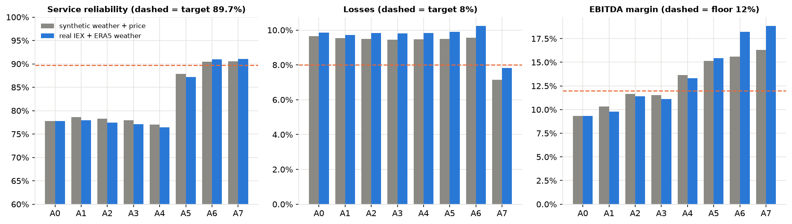

| Step | Reliability (synthetic / real) | Losses (synthetic / real) | EBITDA margin (synthetic / real) |
|---|---|---|---|
| A0 Incumbent rules | 77.8% / 77.8% | 9.6% / 9.9% | 9.3% / 9.3% |
| A1 + ML forecasts | 78.6% / 77.9% | 9.5% / 9.7% | 10.3% / 9.8% |
| A2 + deterministic MPC | 78.3% / 77.5% | 9.5% / 9.8% | 11.6% / 11.4% |
| A3 + stochastic CVaR plan | 77.9% / 77.1% | 9.4% / 9.8% | 11.5% / 11.1% |
| A4 + dynamic pricing | 77.0% / 76.4% | 9.5% / 9.8% | 13.6% / 13.3% |
| A5 + hub steering | 87.9% / 87.2% | 9.5% / 9.9% | 15.2% / 15.4% |
| A6 + renewable sales and pack rebalancing | 90.5% / 91.0% | 9.6% / 10.2% | 15.6% / 18.2% |
| A7 + SiC chargers | **90.5% / 91.0%** | **7.1% / 7.8%** | **16.3% / 18.8%** |

| Other results (A7, full AI) | Synthetic | Real |
|---|---|---|
| Network EBITDA | ₹706 Cr | ₹824 Cr |
| Weakest cluster margin (Chennai) | 12.6% | 13.7% |
| Reliability with no steering (σ_max = 0) | 79.0% | 79.0% |
| Steering needed for 89.7% reliability | σ_max ≈ 0.65 | σ_max ≈ 0.62 |
| Margin in the compound stress window | 11.7% | 16.5% |
| Resampled years with every cluster above 12% margin | 86% | 99% |
| Price forecast error (naive → ML) | 16.5% → 14.4% (better) | 12.7% → 13.2% (worse) |

**What the comparison shows:**
- **Reliability conclusions do not depend on the data source.** Steering takes reliability from about 77% to 87–88% in both runs, and the full framework reaches 90.5% (synthetic) and 91.0% (real). The same hub-overflow mechanism drives both, so this result rests on the steering assumption (Section 11.2), not on prices or weather.
- **Profit conclusions are more sensitive.** Both runs clear 12%, but margin is 16.3% on synthetic data and 18.8% on real data, and the weakest cluster has only 0.6 points of headroom on synthetic data. The extra real-data gain appears at step A6 (+2.8 points real, +0.4 synthetic), when surplus renewable sales and battery use start.
- **Synthetic data flatters forecasting.** The ML price forecast beat the naive forecast on synthetic prices (they were built from smooth daily patterns) but not on real prices. Real prices are harder to predict, so a model validated only on synthetic data would overstate forecast value.
- **The conclusion that matters holds in both:** the full framework clears the reliability, loss and margin targets on both synthetic (90.5%) and real (91.0%) data, with the same ranking of levers (steering and pack rebalancing for reliability, the optimiser and renewable use for margin, SiC for losses).
- **Where the two data sets share assumptions** (demand, customer price logs, battery health, steering response), the comparison cannot test them; only a real pilot can.

---

## 15. Limitations

1. **Demand is synthetic** in both runs. The baseline was calibrated to the case, so the improvements are model results, not real-world proof; a real data pilot is needed.
2. **Steering response (σ_max 0.70), hub and station dispersion, and pack rebalancing effectiveness (0.6)** largely determine the reliability and swap results.
3. **Starting margins and fixed costs were chosen by us** so the incumbent starts at 6–12%.
4. **ERA5 grid-cell winds understate wind-farm sites** (capacity factors 6–17%), so renewable output is conservative and more variable than a fleet at good sites.
5. **The grid connection is sized from the load itself** (99th percentile), so grid limits seldom bind outside stress scenarios.
6. **Stress shocks hit actuals only**, with forecasts unchanged; the real-time optimiser sees them immediately.
7. **The operator is a price taker on IEX**, and customers do not switch between competitors beyond the elasticity modelled.
8. **Pricing ignores demand recapture** when choosing hourly prices (it is included in the plan and in the simulated customer behaviour).
9. **The swap network is lightly used by energy** (about 11% of total); swap chargers are about 6% utilised, a consequence of the case's capacity and storage numbers.
10. **Not simulated:** regular retraining of the forecasts on new data (the forecasts are trained once on the training period).
11. **Not implemented:** reinforcement learning, cross-cluster pack transfers, and online degradation updating from live fleet telemetry (degradation is currently fitted offline to synthetic state-of-health records).

---

## 16. Roadmap

| Phase | Months | Deliverable | Gate |
|---|---|---|---|
| 1. Data and forecasting | 0–3 | Data pipeline; LightGBM forecasts with reconciliation; elasticity from real price logs | Cluster demand error below 12%; renewable error below 20% |
| 2. Optimiser in shadow mode | 3–6 | Day-ahead plan and real-time MPC run alongside the incumbent | Plan feasible on 100% of days; modelled savings confirmed |
| 3. Pricing and steering pilot | 6–9 | Dynamic prices and hub steering in Delhi and Mumbai | Measure steering response; need σ_max of at least 0.62 |
| 4. Scale-out | 9–12 | All five clusters; pack rebalancing; surplus renewable sales | Reliability at or above 89.7%; margin above 12% in each cluster |
| 5. Hardware path | 6–36 | SiC chargers at replacement cycle, or accelerated if justified | Losses at or below 8% |
| 6. Advanced | 12+ | RL for real-time control; storage at hot hubs; more clusters | – |

---

## Appendix A. Files and reproduction

- `code/` – the simulation (`params.py` holds every assumption).
- `results/real/` and `results/synthetic/` – charts and tables for each data mode.
- `scripts/` (in the repository) – the data scripts for IEX prices and ERA5 weather.
- **Repository:** [https://github.com/ntirth005/eroh-2026-r2-ev-energy-optimizer](https://github.com/ntirth005/eroh-2026-r2-ev-energy-optimizer) (private until the round closes).

**To reproduce:** install the packages in `requirements.txt`, get the data with the two scripts, then run `./run_pipeline.sh real` (or `synthetic`). It runs the calibration, forecasting, experiments and analysis.
